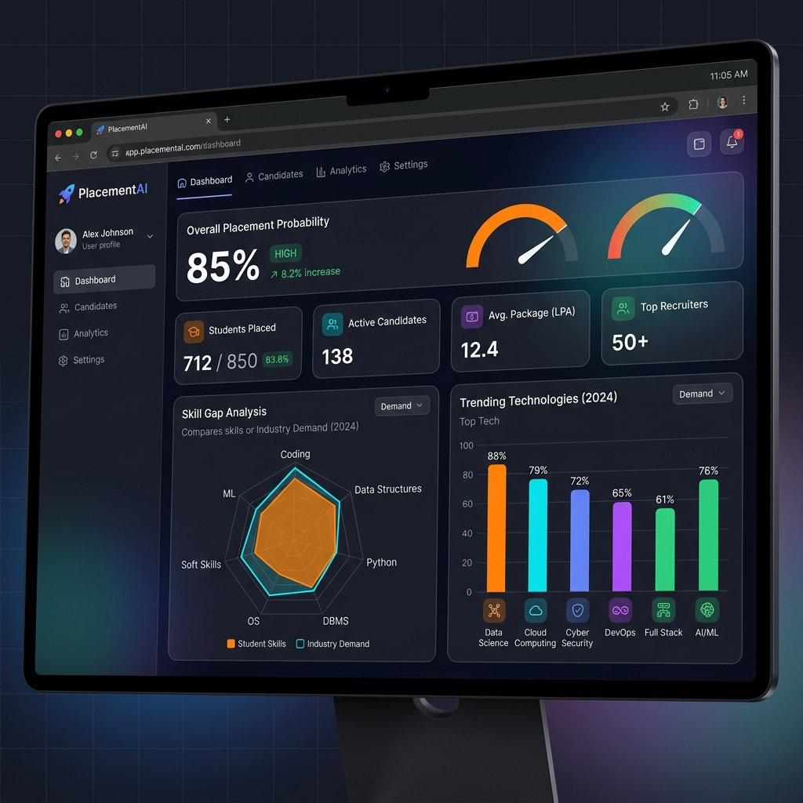
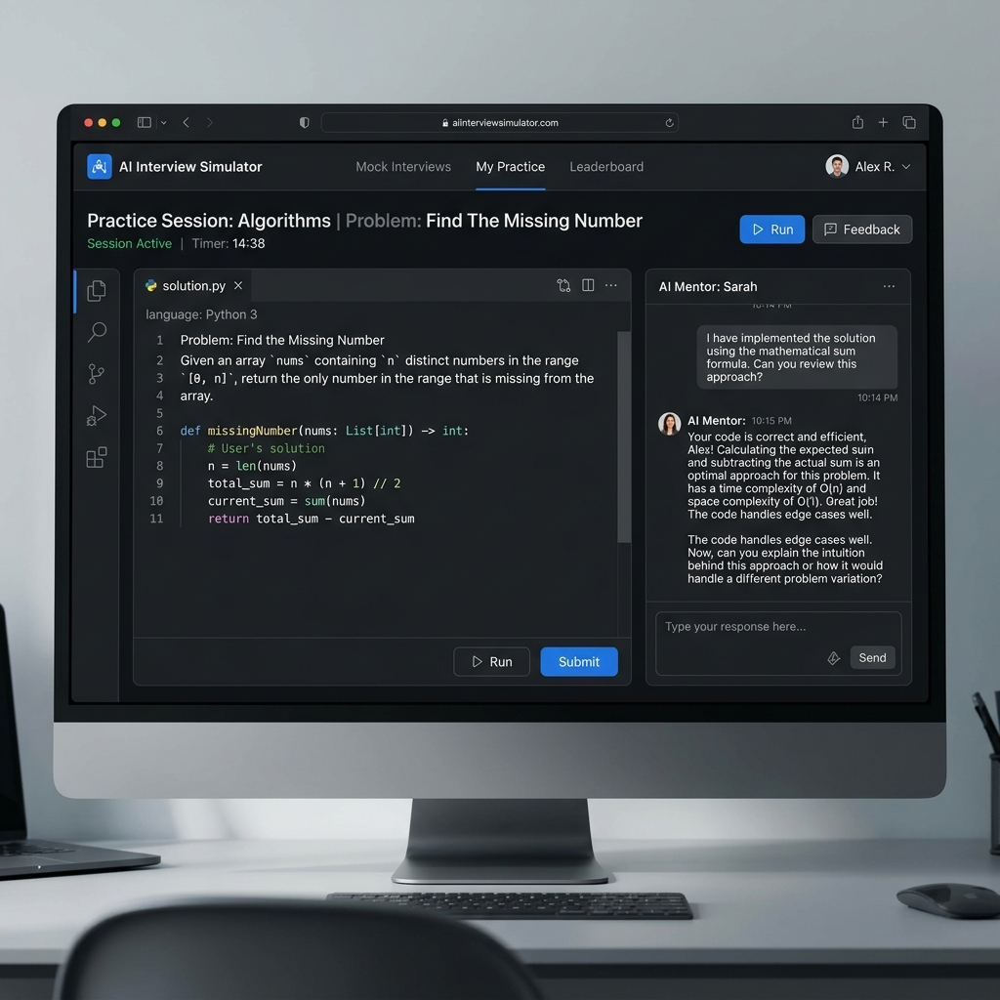
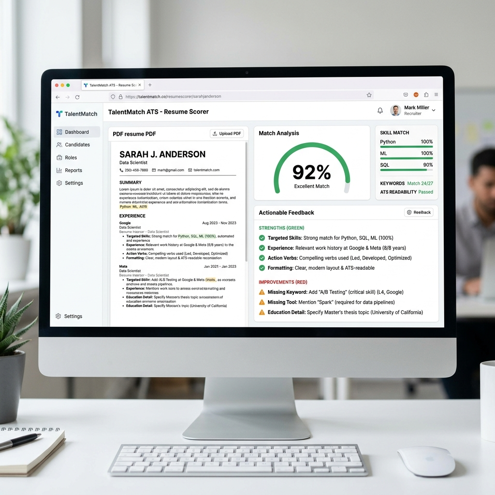

<div align="center">
  <h1>🚀 PlacementAI</h1>
  <p><strong>Your Ultimate AI-Powered Placement & Career Guardian</strong></p>

  [](https://www.python.org/downloads/)
  [](https://flask.palletsprojects.com/)
  [](https://www.mongodb.com/)
  [](https://mistral.ai/)
</div>

---

PlacementAI is a comprehensive, intelligent web platform designed to empower engineering students and job seekers in India. By leveraging advanced Large Language Models (Mistral AI), it identifies skill gaps, simulates realistic interviews, evaluates resumes through ATS algorithms, and provides highly personalized roadmaps to ensure every user is industry-ready and confident for their dream placements.



## ✨ Key Features

1. **📊 Placement Predictor**
   - Calculates your overall placement probability based on CGPA, skills, projects, and target companies.
   - Provides an action plan and highlights your strengths and weaknesses.

2. **🤖 AI Interview Simulator**
   - Engages users in a realistic technical interview. Ask questions natively, get scored by an AI interviewer with detailed breakdown on communication, problem-solving, and tech knowledge.
   
   

3. **📄 ATS Resume Scorer**
   - Upload your PDF/DOCX resume alongside a job description.
   - Gets parsed automatically and receives a format, content, and keyword match score (0-100) detailing exactly what keywords are missing.
   
   

4. **📈 Skill Gap Analyzer & Learning Pathways**
   - Finds critical gaps between your current skill set and your dream roles.
   - Generates fully personalized, day-by-day learning schedules and milestones tailored just for you.

5. **🏢 Company Fit Predictor**
   - Suggests the top 8-10 companies perfect for your profile and gives actionable strategies to clear their unique hiring processes.

6. **💼 AI Project Evaluator & Trend Analysis**
   - Run your GitHub projects through our AI to understand complexity, innovation, and "interview-readiness".
   - Stay updated on 2025 tech hiring trends, remote vs. onsite shifts, and emerging demands.

## 🛠️ Technology Stack

* **Backend:** Python, Flask, Flask-Mail, Flask-Session
* **Database:** MongoDB
* **Artificial Intelligence:** Mistral AI (`mistral-small-latest`)
* **Parsing:** PyMuPDF, `python-docx` for resume extraction
* **Frontend:** Jinja2 Templates, HTML5/CSS3

## ⚙️ Local Setup & Installation

To run this application locally, ensure you have Python 3.9+ and MongoDB installed and running.

1. **Clone the repository** (if hosted):
   ```bash
   git clone https://github.com/yourusername/placementai.git
   cd placementai
   ```

2. **Create a virtual environment:**
   ```bash
   python -m venv venv
   source venv/bin/activate  # On Windows: venv\Scripts\activate
   ```

3. **Install Dependencies:**
   ```bash
   pip install -r requirements.txt
   ```

4. **Environment Variables Config:**
   Create a `.env` file in the root directory and add the following keys:
   ```env
   SECRET_KEY=your_secret_key_here
   MONGO_URI=mongodb://localhost:27017/placementai
   MAIL_USERNAME=your_gmail@gmail.com
   MAIL_APP_PASSWORD=your_gmail_app_password
   MISTRAL_API_KEY=your_mistral_api_key
   ```

5. **Run the Application!**
   ```bash
   python app.py
   ```
   > The platform will be accessible at `http://localhost:5000`

## 🤝 Contributing

Contributions, issues, and feature requests are welcome! Feel free to check the issues page.

---
<div align="center">
  <i>Built to make career success predictable, not accidental.</i>
</div>
